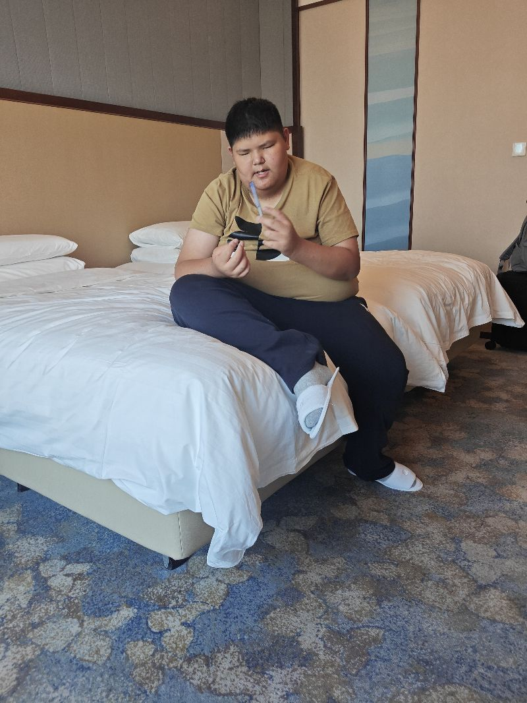
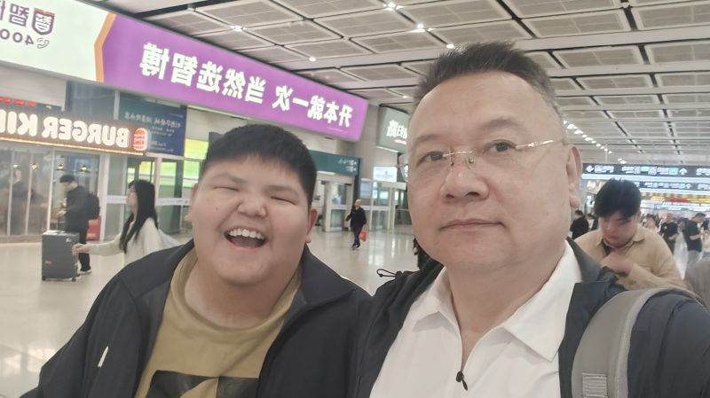

呃整个一年啊，我们有收获有在国事中有挫败也有失败但我相，信这一年的付出和努力都是值得的在失败中学，习在失败中进步是我们整个成镇和包括是我们，这些领导者都一直希望能够进步的遇到问题呢，不放弃不气馁在进步中获得知识获得力量获得，进步获得蜕变啊，那么接下来，呢，我们都知道明年啊，是羊年羊呢，它是善良温柔的动物羊呢，它在十二生肖中是十二地济中是茂啊，我们是绅啊，他的十二纪中被称作生是这个东西呢，是羊的一种象征吧，明年呢，是羊年我们作为师长呢，我作为市场要对明年的一些东西上要做一些提，前的规划和部署明年呢，我们将在重心点发展在军事上因为，今年我们在农业经济和一些社会上都已经有了，很多的进步而反观我们们这年对军军和重视的，并不多所以，明年的重心点啊，当然能国军事和农业上进行展展且在在游业啊，能国国国些的动的和进展所以，明年呢，我们也希望能够在国家的力力越力越强进并且，挤挤进世界强者的行列啊，我们也愿意和大家一同从顶峰俯瞰大家顶峰相，见啊，虽然，对于普通百姓而言这个路很难但是，我们今年呢，将会延续去年的想式继续开创共创思想会把各，位市民的想法和手机投邮箱的方式投到我们的，市政府里我们的市政府的这个共享思想的这个，活动非常乐于啊，让大家给我们提供建议你们的想法你们的社会，发明和你们对于某个行业中的想法我们都可以，借鉴让普通市民也能够成为行业大佬谢谢大家，不知道，

